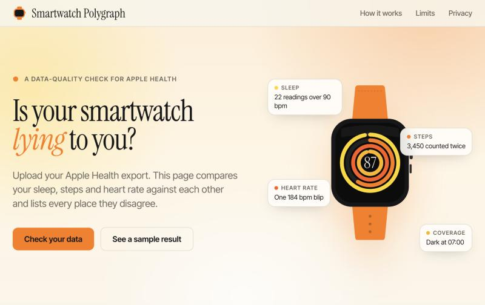
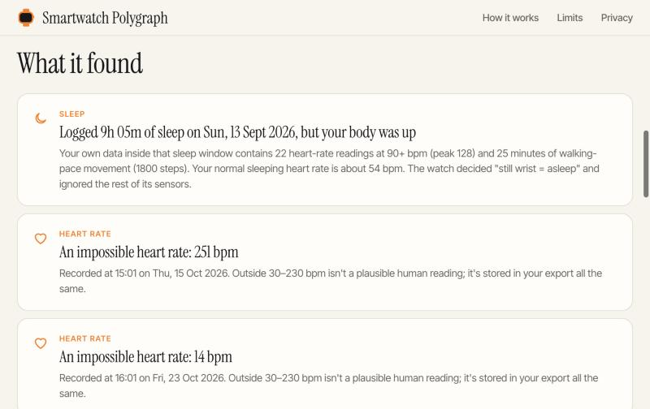

# Smartwatch Polygraph

**Is your smartwatch lying to you?** Upload an Apple Health export and Polygraph cross-examines it: your sleep against your heart rate, your phone's steps against your watch's, your heart rate against itself. It lists every place your own data contradicts itself and rolls them into a 0–100 trust score.

**Live:** [smartwatch-polygraph.vercel.app](https://smartwatch-polygraph.vercel.app) · Everything runs in your browser. The export is never uploaded.



## Why

Wearable data is starting to feed research and clinical workflows, and the file you get out of a phone is messier than the app suggests. The raw Apple Health export contains steps counted by both the phone and the watch, sleep logged while the pulse says you were up, and heart-rate readings no human could produce. Apple's own Health app cleans some of this up. Anything that reads the export directly does not.

Polygraph doesn't need a ground-truth device to catch this. It looks for places where two signals that should agree, don't.

## What it finds

| Check | The contradiction | Example finding |
|---|---|---|
| Sleep vs. body | Heart rate or walking-pace steps inside a window logged as sleep | "Logged 9h 05m of sleep, but your body was up" |
| Sleep vs. itself | Two sources logging the same night, sleeps over 12 hours, sleep with no pulse data | "13h 30m of sleep: the watch was probably on a table" |
| Steps | Phone and watch counting the same minutes twice | "8,379 steps, but you only moved 4,929" |
| Heart rate | Readings outside 30–230 bpm, single-reading spikes outside workouts | "71, then 184, then 73 bpm within minutes" |
| Coverage | Recurring charging gaps and days with no data | "Your watch goes dark around 07:00 on 25 of 61 days" |



## How the score works

Four sub-scores, each 0–100, combined as a weighted mean. A sub-score with no data (for example, no sleep records) drops out and the remaining weights are renormalised.

| Sub-score | Weight | How it is computed |
|---|---|---|
| Sleep | 30% | Mean trust of each night, weighted by hours asleep |
| Steps | 25% | `100 × (1 − min(1, 1.5 × inflation))`, minus up to 20 for implausible cadence |
| Coverage | 25% | Mean over days of `min(1, hours with watch data ÷ 18)` |
| Heart rate | 20% | `100 − min(100, 4000 × bad readings ÷ all readings)` |

| Overall | Grade |
|---|---|
| 90–100 | Trustworthy |
| 75–89 | Mostly honest |
| 55–74 | Gets creative |
| 35–54 | Unreliable narrator |
| 0–34 | Pathological liar |

### The rules in detail

**Sleep.** Asleep intervals are merged into sessions (gaps up to 90 minutes). Sessions with at least 90 minutes asleep are scored. The heart-rate ceiling for a night is `max(90, median sleeping heart rate + 30)`. Conflict minutes are the minutes within two minutes of a reading at or above the ceiling, plus minutes with 40 or more steps (after de-duplication). A night's trust is `1 − penalties`, and a night is flagged below 0.8:

- Conflict: `min(1, 4 × conflict fraction)` when there are at least 15 conflict minutes and the fraction is at least 5%, otherwise a small penalty capped at 0.15.
- Longer than 12 hours asleep: 0.25.
- Duplicate sources, when summed intervals exceed the union by more than 25%: `min(0.4, 0.4 × (ratio − 1))`.
- Logged by a watch with fewer than one heart-rate reading per two hours: 0.2.

**Steps.** Each minute is de-duplicated to the highest of watch, phone and other sources. Inflation is `raw total ÷ de-duplicated total − 1`. A minute above 250 steps counts as implausible cadence.

**Heart rate.** A reading is bad if it falls outside 30–230 bpm, or if it is a blip: it differs by at least 60 bpm from both neighbours, the neighbours are within 25 bpm of each other and within 10 minutes, and it is not inside a workout (padded by 10 minutes).

**Coverage.** An hour counts as covered if it holds at least one heart-rate reading (or any steps, when there are fewer than 100 heart-rate readings). Gaps of 1–5 hours are treated as charging or off-wrist time. A gap is "recurring" when the same start hour appears on at least 30% of days.

**Sources.** Source names containing watch, Fitbit, Garmin, Whoop, Oura, band, Polar, Coros or Suunto are treated as watch; iPhone, phone and iPad as phone; anything else as other.

The weights and thresholds are hand-picked. They have not been validated against a clinical reference.

## How it works

```
export.zip ─▶ stream unzip ─▶ tag parser ─▶ analyzer ─▶ report
 (fflate)      (chunked)      (Record,      steps by minute   scores,
                              Workout)      heart-rate series findings,
                                            sleep intervals   daily map
                                            workouts
```

The file is read as a stream, decoded in chunks and scanned for `Record` and `Workout` tags, so only the records that matter are kept in memory. It is built to handle large exports, but it has not been benchmarked on multi-gigabyte files yet. `analyzer.js` has no browser dependencies and runs in Node as well, which is how the tests run.

## Run it

It is a static site with no build step.

```bash
python3 -m http.server 8741
```

Open <http://localhost:8741>, drop in an `export.zip` or `export.xml`, or press **Use sample data**. Unzipping loads [fflate](https://github.com/101arrowz/fflate) from a CDN once; if you are offline, unzip the export yourself and drop `export.xml`.

To get an export: Health app → your profile picture → **Export All Health Data**.

## Test

`sample.js` generates a synthetic export with known faults planted in it: a night spent dancing, a night logged by two sources, a watch left on a desk, heart-rate glitches, a dead day. `test.js` checks that each one is found, and that the parser copes with records split across chunk boundaries.

```bash
node test.js
```

## Privacy

The page has no backend. The export is parsed in the tab and nothing is sent anywhere. The only network requests are the page's own files, the fflate library and Google Fonts.

## Status and limits

- **Tested on synthetic data only.** The thresholds have not yet been calibrated against real exports, so expect false positives and misses until they are.
- **It finds contradictions, not sensor error.** Two signals disagreeing means something is off. It doesn't say which one, or whether the sensor is accurate.
- **Apple Health only.** Fitbit exports (Google Takeout) are daily JSON files whose exact schema could not be confirmed from public documentation. Garmin's account export has sleep and daily summaries but no minute-level heart rate or steps, so the headline checks can't run on it.
- **Not a medical device.** It checks data quality and doesn't diagnose, monitor or advise.

Next: calibrate on real exports, add a Fitbit adapter, and read Garmin FIT files for the checks that need minute-level data.

## Repository

| File | Purpose |
|---|---|
| `index.html` | The interface: hero animation, upload, results, share card |
| `analyzer.js` | Streaming parser and the checks (browser and Node) |
| `sample.js` | Synthetic export generator with known faults |
| `test.js` | Engine test |
| `favicon.svg`, `favicon.ico`, `apple-touch-icon.png` | Icons |
| `docs/` | README images |

## Author

Designed and built by [Fariha Batool](https://www.linkedin.com/in/fariha-batool/) · [GitHub](https://github.com/batool-fariha)
